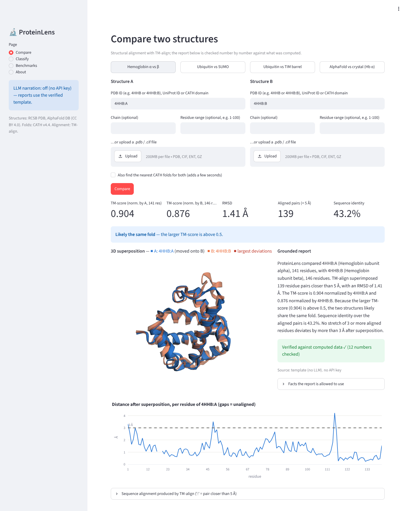
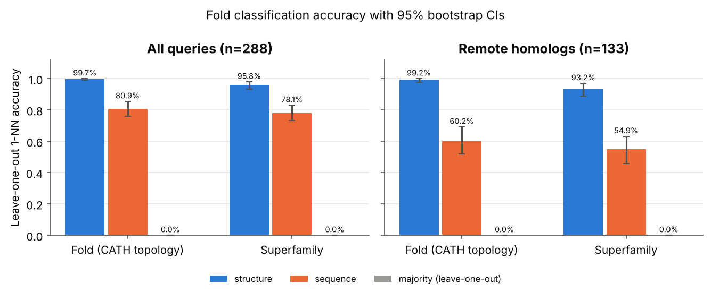
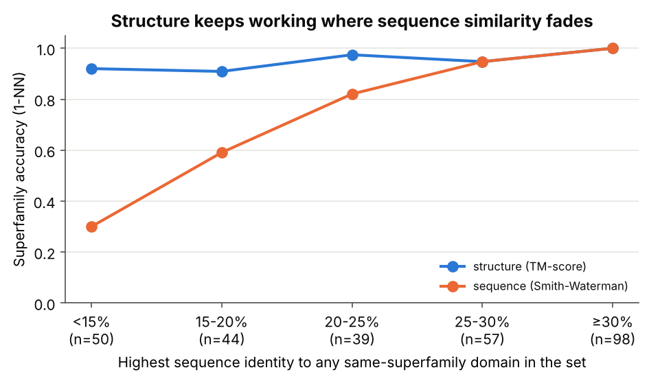
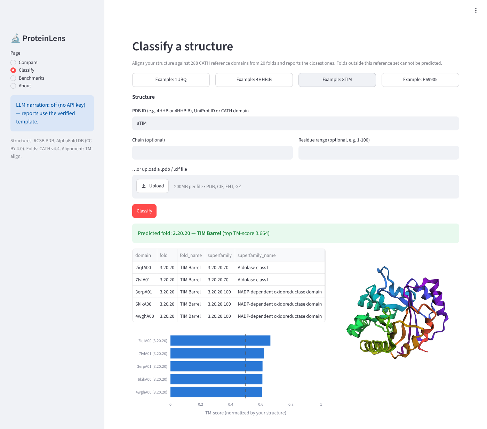
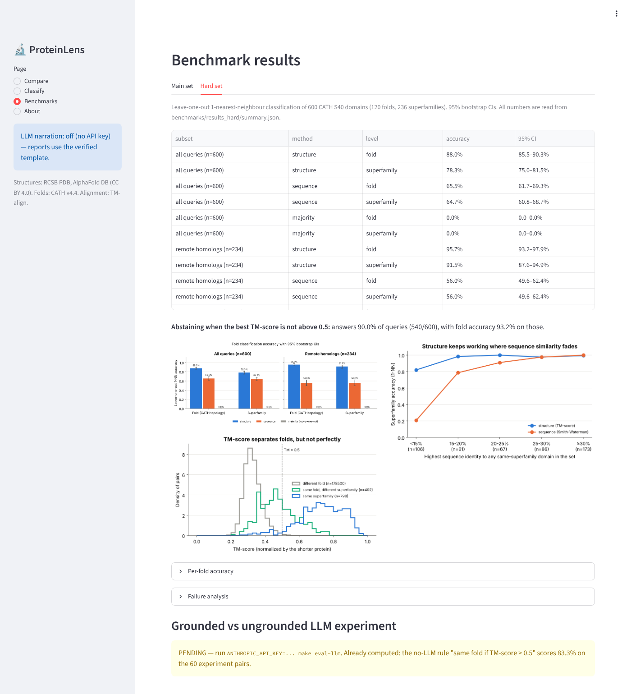

# ProteinLens

**Compare protein 3D structures, classify their fold against CATH, and get plain-English
reports in which every number is checked against what was actually computed.**



A language model can talk about proteins from memory, and it can be confidently wrong. ProteinLens
keeps the model away from the science:

1. **Structural similarity is computed**, with TM-align on C-α atoms, not recalled.
2. **Fold classification is measured** against a ground-truth answer key (CATH v4.4) on a
   non-redundant benchmark, with confidence intervals and a failure analysis.
3. **The LLM only narrates a facts object**, and an automatic **faithfulness checker** verifies
   every number, identifier, fold name and same/different-fold claim in its output. Reports that
   fail are regenerated, then replaced by a template report. Without an API key the template is
   used, so everything works offline.
4. A **grounded vs ungrounded experiment** asks whether giving an LLM the computed facts changes
   its accuracy (pipeline built and tested; live run PENDING, see below).

## Headline results

Leave-one-out 1-nearest-neighbour classification of **288 CATH S40 domains** (20 folds,
60 superfamilies; no two domains share ≥ 40 % sequence identity by CATH's clustering).
95 % percentile-bootstrap confidence intervals (2,000 resamples, seed 0). Source:
[`benchmarks/results/summary.json`](benchmarks/results/summary.json).

| Method | Fold (CATH topology) | Superfamily |
|---|---|---|
| **Structure** (TM-score 1-NN) | **99.7 %** [99.0, 100.0] (287/288) | **95.8 %** [93.4, 97.9] (276/288) |
| Sequence (Smith-Waterman 1-NN) | 80.9 % [76.0, 85.4] (233/288) | 78.1 % [73.3, 83.0] (225/288) |
| Majority class (leave-one-out) | 0.0 % (largest class = 5.2 % of the set) | 0.0 % (largest class = 4.5 %) |

**Remote homologs** (n = 133 queries whose same-superfamily relatives all share < 25 % sequence
identity with them):

| Method | Fold | Superfamily |
|---|---|---|
| **Structure** | **99.2 %** [97.7, 100.0] (132/133) | **93.2 %** [88.7, 97.0] (124/133) |
| Sequence | 60.2 % [51.9, 69.2] (80/133) | 54.9 % [45.9, 63.2] (73/133) |

Structure minus sequence (paired bootstrap): +17.7 points [12.8, 22.6] at superfamily level on
all queries, and **+38.4 points [29.3, 47.4] on remote homologs**. As sequence identity falls below
20 %, the sequence baseline collapses (30.0 % superfamily accuracy below 15 % identity, n = 50) while
structure stays at 92.0 %:

<p float="left">
  
  
</p>

### A harder second benchmark (pre-specified)

The main set gives every query 10–14 members of its own fold. To test the realistic case of many
folds with few examples, a second set was designed and committed **before** it was run: **600
domains from 120 random folds, 5 per fold** (seed 2026, same filters). Source:
[`benchmarks/results_hard/summary.json`](benchmarks/results_hard/summary.json).

| Hard set | Fold | Superfamily |
|---|---|---|
| **Structure** (TM-score 1-NN) | **88.0 %** [85.5, 90.3] (528/600) | 78.3 % [75.0, 81.5] (470/600) |
| Sequence (Smith-Waterman 1-NN) | 65.5 % [61.7, 69.3] (393/600) | 64.7 % [60.8, 68.7] (388/600) |
| Structure, queries with a superfamily partner (n = 493) | | **95.3 %** [93.5, 97.0] |
| Sequence, queries with a superfamily partner (n = 493) | | 78.7 % [75.0, 82.6] |
| Structure / sequence, remote homologs (n = 234) | | 91.5 % [87.6, 94.9] / 56.0 % [49.6, 62.4] |

Accuracy drops from 99.7 % to 88.0 % at fold level, as stated in advance. The errors have a clear
cause: in **95.8 % of the 72 fold errors the nearest neighbour is longer than the query** (median
1.9× longer, vs 1.02× for correct predictions). A small domain, often a small helical bundle, can be
superimposed onto *part* of a bigger protein. Accuracy is 78.8 % for the shortest third of queries
and 95.5 % for the longest third ([hard-set failure analysis](benchmarks/results_hard/FAILURE_ANALYSIS.md)).

**Knowing when not to answer.** If ProteinLens answers only when the best TM-score is above 0.5 (the
literature threshold, not tuned), it answers 90.0 % of hard-set queries with 93.2 % [90.9, 95.2]
fold accuracy, and 98.3 % of main-set queries with 100.0 % (283/283).

### Improving the classifier, confirmed on held-out data

The hard set's errors pointed to a fix: rank by a **coverage-aware score** (the smaller of the two
TM-scores, so a match must cover *both* proteins). To avoid tuning on data already seen, the main
and hard sets were treated as **development** data: a fixed rule (`benchmarks/select_score.py`)
chose the score there, and a **new held-out test set** was built afterwards (600 domains, 120 random
folds, seed 7777, no domain shared with the other sets) and committed before it was run. Fold
accuracy, leave-one-out 1-NN:

| Set | Original score (query-normalized) | Coverage-aware score | Change, points [95% CI] |
|---|---|---|---|
| Main (development) | 99.7 % [99.0, 100.0] | 99.0 % [97.6, 100.0] | -0.7 [-1.7, 0.0] |
| Hard (development) | 88.0 % [85.5, 90.3] | 92.0 % [89.8, 94.0] | +4.0 [2.3, 5.8] |
| **Held-out test** | 84.8 % [82.0, 87.8] | 89.5 % [87.0, 91.8] | +4.7 [2.7, 6.7] |

The gain replicated on data it was not chosen on, so by the pre-registered rule the coverage-aware
score is now the **default ranking** in `proteinlens classify`, reports and the app. (Superfamily
accuracy changed by +0.8 [-0.7, 2.3] points on the test set, which is not a clear difference.) On
the test set, sequence 1-NN scores 57.5 % [53.5, 61.3] at fold level, and on remote homologs
(n = 270) structure finds the superfamily 92.2 % [88.9, 95.2] of the time vs 48.1 % [41.9, 54.1]
for sequence. Source: [`benchmarks/results_test/summary.json`](benchmarks/results_test/summary.json).

### Results website

[`site/index.html`](site/index.html) is a self-contained page with four guided 3D comparisons, an
**explorer for all 1,474 benchmark domains** (search any domain, see its closest match superimposed
in 3D, its top-5 matches and whether the predicted fold was right), all three benchmark sets, the
score improvement and the checker demo. It is generated from the result files by
`python site/build_site.py`, and a test fails if it is out of date. To publish it on GitHub Pages, enable
Pages with source "GitHub Actions" in the repository settings; `.github/workflows/pages.yml` then
deploys it on every push to `main`.

**Read these numbers with care** (details in [Limitations](#limitations) and the
[failure analysis](benchmarks/results/FAILURE_ANALYSIS.md)): the benchmark is clean and small
(20 well-populated folds, X-ray domains ≤ 2.5 Å), and CATH itself is built partly from structure
comparison, so agreement with CATH is partly expected. The one fold error and the 12 superfamily
errors are all between neighbouring topologies or superfamilies of the same fold.

**Grounded vs ungrounded LLM experiment: PENDING — run `make eval-llm` with an API key.** No LLM
accuracy is reported because no API key was available when this was built. Already computed on the
experiment's 60 pairs: the no-LLM rule "same fold if TM-score > 0.5" scores 83.3 % [73.3, 93.3]
(100 % on same-superfamily pairs, 50 % on same-fold/different-superfamily pairs, 100 % on
different-fold pairs). See [`benchmarks/results/llm_experiment/`](benchmarks/results/llm_experiment/README.md).

## Quickstart (60 seconds)

```bash
git clone https://github.com/bafood123/proteinlens.git && cd proteinlens
make setup                 # creates .venv and installs pinned dependencies (Python ≥ 3.12)
make test                  # offline tests (bundled fixtures; no network needed)
make app                   # web app at http://localhost:8501
```

Command line:

```bash
.venv/bin/proteinlens compare 4HHB:A 4HHB:B        # hemoglobin α vs β
.venv/bin/proteinlens compare 1UBQ 1WM3 --json      # ubiquitin vs SUMO, full result as JSON
.venv/bin/proteinlens classify 8TIM                 # nearest CATH folds
.venv/bin/proteinlens report 1UBQ 1WM3              # verified plain-English report
.venv/bin/proteinlens info P69905                   # AlphaFold model by UniProt ID
```

Inputs can be PDB IDs (`4HHB`, `4HHB:B`, `4HHB:B:1-100`), UniProt accessions (AlphaFold DB
models), CATH domain IDs (`1cukA01`) or local `.pdb`/`.cif` files. Downloads are cached in
`data/cache/`.

Optional LLM narration: copy `.env.example`, set `ANTHROPIC_API_KEY` (and optionally
`PROTEINLENS_MODEL`, default `claude-opus-5-5`). Reports are still checked; failures fall back to
the template.

Reproduce the benchmark: `make benchmark` (≈ 8 minutes on 4 CPUs; resumable) or
`make benchmark-smoke` (40 domains, ≈ 10 s). The harder second benchmark: `make benchmark-hard`;
the held-out test: `make benchmark-test` (≈ 30 minutes each; if one stops at its time limit, run it
again to resume). Rebuild the website: `python site/build_site.py`.

## How it works

| Module | What it does |
|---|---|
| `proteinlens/data.py` | Fetches and caches RCSB PDB entries, AlphaFold DB models and CATH domains; selects a chain/range; strips water and ligands; keeps one copy of alternate-location atoms; detects chain breaks; pulls metadata (title, organism, resolution, ligands, pLDDT). |
| `proteinlens/align.py` | TM-align (via `tmtools`): TM-score normalized by each protein, RMSD, aligned length, identity, rotation/translation, per-residue distances and the most deviating regions. Results are exactly symmetric under swapping. Also the Smith-Waterman sequence baseline. |
| `proteinlens/classify.py` | 1-NN fold classification against the bundled 288-domain CATH reference set. |
| `proteinlens/report.py` | Builds the facts object, the template report and the generate → check → regenerate → fallback loop. |
| `proteinlens/verify.py` | The faithfulness checker. |
| `proteinlens/llm.py` | Claude client (official `anthropic` SDK, structured JSON output), mock client and response cache. |
| `proteinlens/experiment.py` | Grounded vs ungrounded experiment. |
| `app/streamlit_app.py` | Compare / Classify / Benchmarks pages, 3D superposition with 3Dmol.js. |
| `benchmarks/` | Dataset builder, all-vs-all runner, analysis, results and figures ([details](benchmarks/README.md)). |

The faithfulness checker is tested on deliberately corrupted reports: wrong TM-score, wrong RMSD,
wrong counts, an invented derived number, a flipped or negated fold verdict, a PDB ID or CATH code
from memory, a fold name from memory, and functional or evolutionary claims (`tests/test_verify.py`).

More: [plain-language explainer](docs/UNDERSTANDING.md) · [paper-style write-up](docs/WRITEUP.md) ·
[deploying the app](docs/DEPLOY.md) · [design decisions](DECISIONS.md) · [progress log](PROGRESS.md).

| Classify | Benchmarks |
|---|---|
|  |  |

## Limitations

* **Clean benchmarks.** The main set has 20 folds with ≥ 10 eligible members each; the hard set
  (120 folds, 5 each) shows that accuracy drops to 88.0 % when examples are scarce. Both use X-ray
  domains at ≤ 2.5 Å, 50–300 residues, already cut into domains by CATH. Real inputs (multi-domain
  chains, NMR models, low-confidence predictions, folds absent from the reference set) are harder
  still. 1-NN cannot predict a fold that is not in its reference set; the app warns when the best
  TM-score is ≤ 0.5.
* **Size bias, now reduced.** The original query-normalized score let small domains match fragments
  of large proteins. The coverage-aware score fixes much of this (+4.7 points on held-out data) and
  is the default, but it cost 0.7 points on the easy main set and does not help superfamily
  accuracy clearly. The headline tables for the main and hard sets still report the pre-specified
  original score.
* **Circularity with the answer key.** CATH uses structural comparison when classifying domains,
  so high agreement between a structure method and CATH is partly built in. The meaningful
  comparison is structure vs sequence on the same queries.
* **Residual redundancy.** 9 of 41,328 pairs exceed 40 % identity by our measure (identical
  residues ÷ shorter length), because CATH's S40 clustering uses different identity/overlap
  rules. They were kept and disclosed rather than removed after seeing results.
* **Score choices are reported, not hidden.** The main and hard tables use the score fixed in advance
  (TM-score normalized by the query). Other normalizations appear only as sensitivity analyses,
  and the one change of default was made on development data and confirmed on a held-out set.
* **The superfamily boundary is partly a curation decision.** Several "errors" are domains from
  the same kind of enzyme that CATH places in different superfamilies of one fold.
* **The faithfulness checker is narrow.** It verifies numbers, identifiers, fold names from a
  vocabulary, the fold verdict, and a list of functional and evolutionary keywords. It cannot prove
  that a fluent sentence without such tokens is correct or well chosen. It does not make the LLM
  "understand" proteins; the honest claim is that the structure is computed and the narration is
  checked against it.
* **The LLM experiment has not been run** (no API key at build time).
* **TM-score > 0.5 is a rule of thumb**, not a law: 50.6 % of same-fold/different-superfamily
  pairs and 91.2 % of same-superfamily pairs exceed it, versus 0.44 % of different-fold pairs.

## How this was built

ProteinLens was built with AI coding assistance (Claude Code) from a written project brief. All
results in this README, the write-up and the app were produced by the scripts in this repository
(`make benchmark`, `make eval-llm`) and are read from the committed result files. None were typed
in by hand. The decision log is in [`DECISIONS.md`](DECISIONS.md).

## Data, software and licenses

Code: MIT ([LICENSE](LICENSE)). ProteinLens depends on (but does not include) **tmtools**, a Python
binding to **TM-align**, which is licensed **GPL-3.0**. If you redistribute a bundle that includes
tmtools, its license applies to that bundle. Data: **RCSB PDB** (structures and metadata), **AlphaFold
DB** (CC BY 4.0), **CATH** v4.4 (CC BY 4.0), **UniProt** accessions. Software: TM-align, Biopython,
3Dmol.js, Streamlit, Plotly. Full references are in [CITATIONS.md](CITATIONS.md).
